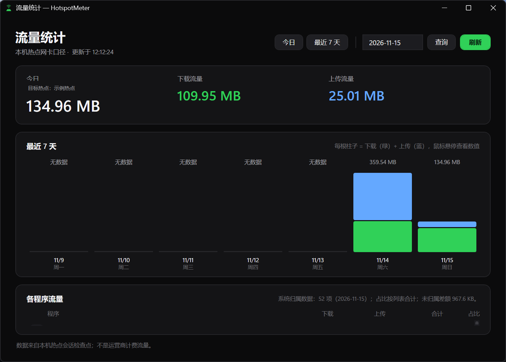

# <div align="center">HotspotMeter</div>

<div align="center">

### Windows 手机热点流量监控工具

**一眼掌握热点流量，轻松了解网络使用情况。**

<br>


**简体中文** | [English](README.md)

</div>

---


HotspotMeter 是一款面向 Windows 用户的桌面流量监控工具，帮助你直观了解手机热点连接状态、实时网络流量以及各应用程序的流量消耗。

无需频繁打开系统设置，通过桌面悬浮窗口即可掌握热点流量使用情况。

## ✨ 功能特性

- **实时流量监控**：显示当前热点连接状态、会话流量和实时上传/下载速度。
- **桌面悬浮胶囊**：轻量、简洁的悬浮窗口，方便随时查看流量。
- **灵活调整尺寸**：提供多种预设尺寸，支持自定义窗口大小。
- **位置固定**：支持固定悬浮窗口位置，避免误操作。
- **任务栏适配**：提供任务栏显示模式，优化桌面使用体验。
- **历史流量统计**：支持今日、最近 7 天和指定日期的流量查询。
- **应用程序流量统计**：展示 Windows 网络 API 提供的逐应用程序流量归属数据。
- **系统托盘管理**：通过托盘菜单访问统计窗口和管理程序。
- **开机自启动**：支持设置程序随 Windows 启动。
- **后台持续监控**：关闭统计窗口后，后台流量监控仍会继续运行。

> 注意：逐应用程序流量统计依赖 Windows 提供的网络归属数据，部分系统服务或应用程序的流量可能无法准确归属。因此，逐应用程序统计之和可能与总流量存在差异。HotspotMeter 不会人为分摊或伪造流量数据。

## 🖥️ 界面预览

| 桌面悬浮胶囊 | 流量统计窗口 |
|:---:|:---:|
|  |  |

*统计窗口截图中的热点名称已替换为占位符，其余内容来自真实运行。*

## 🛠️ 技术栈

- **开发语言**：C#
- **桌面框架**：WPF
- **运行平台**：Windows
- **数据存储**：SQLite
- **网络数据**：Windows Network APIs、WinRT Network Usage API
- **系统交互**：Win32 API

## 📋 系统要求

- **Windows 10 1809（build 17763）及以上，或 Windows 11**，x64。
- 发布的**自包含**版本不要求单独安装 .NET Desktop Runtime。
- 从源码构建需要 **.NET 10 SDK**（项目目标框架为 `net10.0-windows10.0.26100.0`）。
- 正常使用不要求管理员权限；可选“开机自启”只写入当前用户的 `HKCU\Software\Microsoft\Windows\CurrentVersion\Run`。

## 🚀 安装与运行

### 便携版 ZIP（当前发布形式）

1. 从发布附件下载 `HotspotMeter-win-x64.zip`。
2. 解压到你有写权限的目录，例如 `%LOCALAPPDATA%\Programs\HotspotMeter`。
3. 运行 `HotspotMeter.exe`。
4. 首次启动选择 **简体中文** 或 **English**；选择会被记住，之后可在设置中切换。

ZIP 为自包含版本，请保持解压目录中的文件完整。目前**没有安装程序**，采用便携、当前用户级的方式，避免对系统做全局修改。具体构建与验证状态见 `docs/12_Release_Notes.md`。

### 从源码构建

```bash
git clone https://github.com/Sharkin-Tao/HotspotMeter.git
cd HotspotMeter
dotnet restore
dotnet build -c Release
dotnet test -c Release
```

生成同样的便携版本：

```bash
dotnet publish HotspotMeter.App -c Release -r win-x64 --self-contained true \
  -p:PublishSingleFile=false -p:DebugType=None -p:DebugSymbols=false \
  -o artifacts/release/HotspotMeter-win-x64
```

## 📊 数据存储

HotspotMeter 将用户数据保存在程序目录之外：

| 数据 | 位置 |
|---|---|
| SQLite 历史数据库 | `%LOCALAPPDATA%\HotspotMeter\Database\hotspotmeter.db` |
| 窗口与设置状态（`ui-state.json`） | `%LOCALAPPDATA%\HotspotMeter\ui-state.json` |
| 日志（仅在诊断/启用时产生） | `%LOCALAPPDATA%\HotspotMeter\logs\` |

安装目录**不包含**数据库、日志或个人配置，因此替换程序目录不会覆盖历史记录。数据库中包含本机流量历史和热点配置信息，分享诊断信息时请按个人数据处理。

## 🗑️ 卸载

1. 从托盘菜单选择 **退出**。
2. 如果开启过“开机自启”，先在设置中关闭（会删除本程序自己的 `Run` 项）。
3. 删除解压后的程序目录。
4. 可选：删除 `%LOCALAPPDATA%\HotspotMeter` 以清除历史与设置。程序有意不自动删除该目录，方便重装后保留历史。

## ⚠️ 已知限制

- 只统计你选定热点对应的 Wi-Fi 网卡，不叠加 VPN、虚拟网卡或其他接口；数据是电脑侧网卡字节数，可能与中国移动等运营商的计费流量不同。
- 逐程序归属由 Windows 提供，可能不完整；未归属流量单独展示，不会分摊给应用。
- Windows 11 的部分 Shell 界面（展开的开始菜单/搜索、UAC 安全桌面、锁屏）位于比普通置顶窗口更高的窗口层级，胶囊无法保证显示在其上方；这些界面关闭后会恢复。
- 当前程序未签名，首次运行可能出现 Windows SmartScreen 提示。
- 当前环境无法可靠制作安装包（缺少 Inno Setup/NSIS），因此**安装/卸载程序未验证**；支持方式是上述便携 ZIP 与手动卸载。

## 🐛 问题反馈

如果你在使用过程中遇到问题，欢迎通过 GitHub Issues 反馈。

提交问题时，建议提供：

- Windows 版本
- HotspotMeter 版本
- 问题复现步骤
- 相关截图或日志

请在分享日志或截图前注意隐藏个人隐私信息。

## 📄 License

项目许可证待确定。
