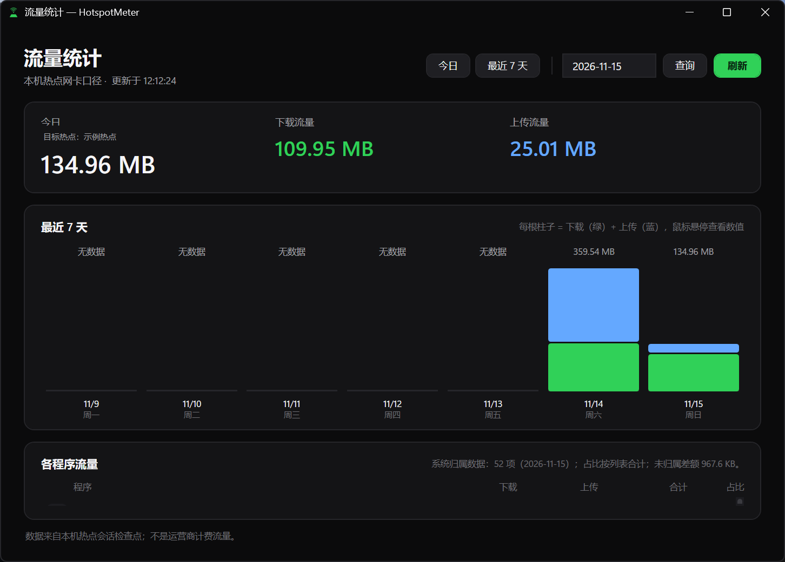

# <div align="center">HotspotMeter</div>

<div align="center">

### Windows Hotspot Traffic Monitor

**Know your hotspot traffic at a glance.**

<br>


[简体中文](README-CN.md) | **English**

</div>

---

HotspotMeter is a desktop traffic monitoring tool for Windows. It helps you keep track of your mobile hotspot connection status, real-time network traffic, and application-level data usage.

Monitor your hotspot traffic directly from your desktop without repeatedly opening Windows Settings.

## ✨ Features

- **Real-time Traffic Monitoring**: View hotspot connection status, session traffic, and upload/download speeds.
- **Desktop Floating Capsule**: A lightweight floating window for convenient traffic monitoring.
- **Flexible Window Sizing**: Multiple preset sizes and custom dimensions.
- **Position Locking**: Lock the floating window in place to prevent accidental movement.
- **Taskbar Adaptation**: A taskbar display mode for a more integrated desktop experience.
- **Historical Traffic Statistics**: View traffic usage for today, the last 7 days, or a selected date.
- **Per-Application Traffic Statistics**: Display application-level traffic attribution provided by Windows network APIs.
- **System Tray Integration**: Access statistics and manage the application from the system tray.
- **Startup on Boot**: Optionally launch HotspotMeter when Windows starts.
- **Background Monitoring**: Traffic monitoring continues even after the statistics window is closed.

> Note: Per-application traffic statistics rely on network attribution data provided by Windows. Some system services or applications may not be accurately attributed, so the sum of application-level traffic may differ from the total traffic. HotspotMeter does not fabricate or artificially distribute traffic data.

## 🖥️ Screenshots

| Desktop Floating Capsule | Traffic Statistics |
|:---:|:---:|
|  |  |

*The hotspot name in the statistics screenshot has been replaced with a placeholder; all other content is from a real run.*

## 🛠️ Tech Stack

- **Language**: C#
- **Desktop Framework**: WPF
- **Platform**: Windows
- **Data Storage**: SQLite
- **Network Data**: Windows Network APIs, WinRT Network Usage API
- **System Integration**: Win32 API

## 📋 Requirements

- **Windows 10 version 1809 (build 17763) or later, or Windows 11**, x64.
- The published self-contained build does **not** require a separate .NET Desktop Runtime installation.
- Building from source requires the **.NET 10 SDK** (the project targets `net10.0-windows10.0.26100.0`).
- Administrator rights are not required for normal use. The optional "start with Windows" switch writes only to the current user's `HKCU\Software\Microsoft\Windows\CurrentVersion\Run` key.

## 🚀 Install and Run

### Portable ZIP (current release form)

1. Download `HotspotMeter-win-x64.zip` from the release assets.
2. Extract the whole folder to a location you control, for example `%LOCALAPPDATA%\Programs\HotspotMeter`.
3. Run `HotspotMeter.exe`.
4. On first launch, choose **简体中文** or **English**. The choice is remembered and can be changed later in Settings.

The ZIP is self-contained; keep all files in the extracted folder together. There is currently **no installer** — a portable, user-scoped package is used deliberately so that no machine-wide changes are made. See `docs/12_Release_Notes.md` for the exact build and verification status.

### Build from source

```bash
git clone https://github.com/Sharkin-Tao/HotspotMeter.git
cd HotspotMeter
dotnet restore
dotnet build -c Release
dotnet test -c Release
```

To produce the same portable build:

```bash
dotnet publish HotspotMeter.App -c Release -r win-x64 --self-contained true \
  -p:PublishSingleFile=false -p:DebugType=None -p:DebugSymbols=false \
  -o artifacts/release/HotspotMeter-win-x64
```

## 📊 Data Storage

HotspotMeter keeps user data outside the program folder:

| Data | Location |
|---|---|
| SQLite history database | `%LOCALAPPDATA%\HotspotMeter\Database\hotspotmeter.db` |
| Window/settings state (`ui-state.json`) | `%LOCALAPPDATA%\HotspotMeter\ui-state.json` |
| Logs (only when enabled/diagnostic builds produce them) | `%LOCALAPPDATA%\HotspotMeter\logs\` |

The install folder contains **no** database, logs, or personal configuration. Updating or replacing the program folder therefore does not overwrite history. The database contains your local traffic history and hotspot profile metadata; treat it as personal data when sharing diagnostics.

## 🗑️ Uninstall

1. Exit HotspotMeter from the tray menu (**Exit**).
2. If "Start HotspotMeter with Windows" was enabled, turn it off first in Settings (this removes the app's own `Run` value).
3. Delete the extracted program folder.
4. Optional: delete `%LOCALAPPDATA%\HotspotMeter` to remove history and settings. This is intentionally **not** done automatically, so reinstalling keeps your history.

## ⚠️ Known Limitations

- Only the Wi-Fi adapter associated with the hotspot you select is counted; VPN, virtual adapters, and other interfaces are not added. The figures are the PC-side adapter byte counts and may differ from carrier billing.
- Per-application attribution comes from Windows and can be incomplete; unattributed traffic is shown separately rather than distributed among apps.
- Some Windows 11 shell surfaces (for example the expanded Start menu/search, UAC secure desktop, and the lock screen) sit in a higher window band than a normal topmost window. The capsule cannot be guaranteed to appear above those surfaces; it recovers after they close.
- The application is currently unsigned, so Windows SmartScreen may show a warning on first run.
- A reliable installer could not be produced in the current environment (Inno Setup/NSIS unavailable); installation/uninstallation via an installer is therefore **not verified**. The portable ZIP and manual uninstall steps above are the supported path.

## 🐛 Feedback & Issues

If you encounter a bug or have a suggestion, feel free to open an issue on GitHub.

When reporting a bug, please include:

- Windows version
- HotspotMeter version
- Steps to reproduce
- Relevant screenshots or logs

Please remove any personal or sensitive information before sharing logs or screenshots.

## 📄 License

The project license has not yet been determined.
